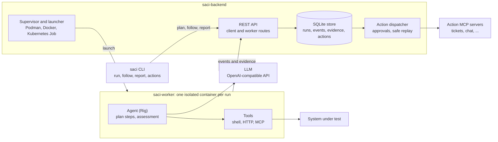

# Architecture

Saci has three parts: the `saci` command line, the backend, and one
isolated worker per run. The backend stores every run and starts its
worker. The worker's agent carries out the test plan with an LLM and
bounded tools, and reports back to the backend.

## How a run flows

1. `saci run` sends the Markdown plan to the backend's
   [REST API](api.md), which stores the run in SQLite
   ([operations](operations.md)).
2. The supervisor starts one isolated worker for the run: a Podman or
   Docker container ([launchers](launchers.md)) or a Kubernetes Job
   ([Kubernetes](kubernetes.md)).
3. The worker's agent works through the plan step by step
   ([execution](execution.md), [sequencing](sequencing.md)). It asks the
   LLM what to do and calls bounded shell, HTTP and MCP tools against the
   system under test ([tools](tools.md), [MCP](mcp.md)).
4. The worker sends events and evidence to the backend with a token valid
   only for its own run ([security](security.md)). Each step's verdict
   cites that evidence ([contracts](contracts.md)).
5. Once the report is final, the action dispatcher may call MCP tools, for
   example to open a ticket ([outcome actions](actions.md)). Actions can
   wait for approval, and a lost answer is replayed only with an
   idempotency key. Actions never change the verdict.

`saci follow` and `saci report` read progress and results back through the
API ([CLI](cli.md)). Runs survive a backend restart
([supervision](supervision.md)).

## Crates

| Crate | Role |
| --- | --- |
| `saci-core` | Shared types: plans, configuration, run contracts, events, reports and outcome actions. |
| `saci-cli` | The `saci` command line. |
| `saci-backend` | REST API, SQLite store, supervisor, launchers and action dispatcher. |
| `saci-worker` | The worker: the agent, its tools and reporting to the backend. |
| `saci-mcp` | MCP client code shared by the worker (step tools) and the backend (actions). |
| `saci-testkit` | Test fixtures: fake model, target, MCP and Kubernetes servers. |
