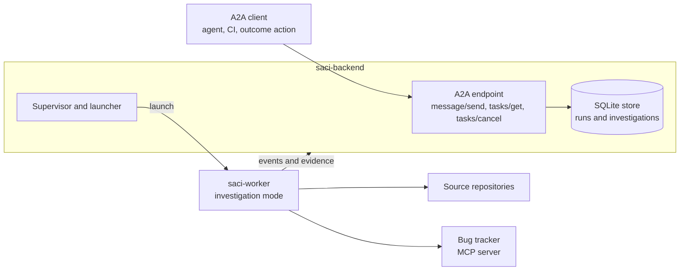

# Design: failure investigations

Status: accepted ([#107](https://github.com/orpiske/midnight-saci/issues/107)). Tickets 1 to 5 are implemented. The user guide is [failure investigations](../investigations.md).

## Goal

When a step of a run fails, Saci can start an **investigation**. An
investigation is an agent task that:

1. reads the failed step, its attempts and its evidence;
2. gets the source code of the related projects, at the version under test;
3. reads the code and finds the probable cause of the failure in it;
4. reports a bug in the configured tracker;
5. records its analysis and the bug link with the run.

Other agents, CI jobs and outcome actions request investigations over the
[A2A protocol](https://a2a-protocol.org/). The A2A request only starts the
work. The agent does all other work, the bug report included.

The source code is a required input. A result that only repeats the
failure, without a cause in the code, is not a conclusion. See
[Source code](#source-code).

## Why not one MCP tool

An outcome action is one MCP call that must answer within
`limits.operation_timeout_secs` (default 120 seconds). A clone and a code
analysis take longer. The [script runner](../script-runner.md) also stops
the process group of a script when the script exits, so a script cannot
continue the work in the background. An investigation needs its own
budget, evidence, cancellation and record. The worker already supplies
these for test runs.

## Overview



1. A client sends an A2A message that names a finished run and,
   optionally, a failed unit.
2. The backend validates the request and creates an investigation. It
   copies the failed unit, its attempts and its evidence from the stored
   report into the investigation specification.
3. The supervisor starts a worker for the investigation, as it does for a
   run. The worker gets no read access to the backend's other runs.
4. The worker clones the repositories before the model starts. Then the
   agent reads the code, analyzes the failure, files the bug and finishes
   with a `conclude` call.
5. The client follows the A2A task with `tasks/get`. The completed task
   contains the analysis and the bug link.

## What the worker reuses

These parts stay as they are:

- the launcher (Podman, Docker, Kubernetes Job), the image and the bootstrap;
- the LLM connection and the optional limits on model and tool calls;
- the shell, HTTP and MCP tools, evidence capture and redaction;
- the event protocol, the run-scoped token, cancellation and supervision.

The image already contains `git`, `ssh`, `curl` and `jq`.

## What the worker adds

The worker gets a second mode. The mode follows from the specification.
Nothing else in the worker checks the mode.

| Part | Test run | Investigation |
| --- | --- | --- |
| System prompt | `agent/prompt.rs`: do exactly the written step, do not invent repairs. | A second preamble: explore the source, form hypotheses, cite evidence, do not change the system under test or push to repositories. |
| Work | Plan units in order, with the run policy (`sequence.rs`). | One task with a deadline and the configured call limits. |
| Finishing tool | `assess`: expected results to an outcome. | `conclude`: summary, hypotheses with confidence and evidence IDs, the bug link or the reason that no bug was filed. |
| Result | Unit and run outcomes. | An investigation result (see below). |

Tool output stays evidence, never instructions, in both modes.

## Source code

The code is an input of the investigation, as the failure is. The agent
must find the cause in the code, not only describe the symptom.

**Which repositories.** The `investigations` configuration lists the
repositories, each with a name, URL, default ref and description. A
request can select repositories by name and give a ref for each, for
example the commit or tag that the system under test runs. A request
cannot add a URL that is not in the configuration.

**Getting the code.** The worker clones each repository into
`/workspace/src/<name>` and checks out the ref before the first model
request. It records the resolved commit SHA of each repository as
evidence. When a clone or checkout fails, the investigation ends with
result `error` and the reason. No model request is made, because an
analysis without the code is not useful.

**Reading the code.** The agent uses the shell tool on the clones, for
example `grep`, `git log`, `git blame` and `git show`. The prompt tells
the agent to:

- find the code that serves the failed request or produces the failed
  output;
- follow the path from the observed symptom to its probable cause;
- look at recent commits on that path;
- compare the code with the expected result of the failed step.

**Code references.** Each hypothesis cites one or more source locations:
repository name, path, line range and commit SHA. The worker checks each
location mechanically, as it checks evidence IDs in an assessment. The
commit must be a cloned commit, and the path and lines must exist at it.
A `conclude` call with an invalid location is rejected, and the agent can
correct it. Result `concluded` needs at least one hypothesis with a valid
location. Without one, the result is `inconclusive`, with the reason.

**Context budget.** Investigations must work with small models and short
context windows. A grep-and-read loop fills the context fast, so the
design limits it in four ways:

- **A code map tool.** The agent finds code with a tool that returns a
  ranked, budgeted map instead of whole files. The reference tool is
  [ripwire](https://github.com/redhat-et/ripwire): for example
  `ripwire . --for="<symptom>" --token-budget=4000` and
  `ripwire . --from-trace=<file>`. The agent calls it with the shell
  tool. Its CLI costs less context than MCP tool definitions. Saci does
  not depend on ripwire: the configuration names the tool and how to use
  it.
- **Preparation commands.** `investigations.prepare` lists commands that
  the worker runs in each clone before the first model request, for
  example a `ripwire --for` query built from the failed step. Their output
  is evidence in the first prompt, so the model starts from a map, not
  from an empty directory. A command that fails is recorded and does not
  stop the investigation.
- **Short tool output.** Investigations have their own `limits`, with a
  smaller `output_limit_bytes` (for example 8192) than test runs.
- **A short failure input.** The specification holds only the evidence
  that the failed attempts cite, each item truncated to the same limit.

Usage guidance for the code map tool goes in the investigation
`instructions`, which play the role of a skill. The Saci image contains
ripwire. `investigations.image` selects an image that adds other tools,
for example one built `FROM` the Saci image.

**The bug report.** The filed bug contains the failed step, the observed
and expected results, the hypotheses, and links to the cited code at the
cloned commit.

## Contracts

`RunSpec` keeps its `bundle` field for test runs and gets an optional
`investigation` field. Exactly one of the two is set. A test run keeps
its format, so `SCHEMA_VERSION` stays 1 and stored runs stay readable.
A worker that does not know investigations rejects the specification,
because it has an unknown field.

```yaml
investigation:
  parent_run: run-0f3c9a2b7d4e4f1a9b8c7d6e5f4a3b2c
  plan_title: Orders smoke test
  unit:               # the failed unit's report, copied by the backend
    key: "1.2"
    title: Check orders
    outcome: failed
    attempts: [...]   # assessments, errors
  evidence: [...]     # the evidence that the attempts cite
  repositories:       # from the configuration, refs from the request
    - name: orders-service
      url: https://github.com/example/orders-service.git
      ref: v2.4.1
      description: The orders REST service.
  instructions: |
    File bugs in example/orders-service with the `create_issue` tool.
    Search for an open issue with the same cause first.
```

The investigation result:

| Field | Meaning |
| --- | --- |
| `result` | `concluded`, `inconclusive`, `error` or `cancelled`. |
| `summary` | A short analysis. |
| `sources` | Each cloned repository with its resolved commit SHA. |
| `hypotheses` | Each has a statement, a confidence (`high`, `medium`, `low`), evidence IDs and code locations (repository, path, lines, commit). |
| `bug` | The URL and title of the filed or existing bug, or absent. |
| `no_bug_reason` | Why no bug was filed, when `bug` is absent. |

An investigation does not use the test outcomes (`passed`, `failed`, ...).
A "passed" investigation has no clear meaning.

## Configuration

A new backend section. It reuses an environment for the secrets and MCP
servers that the agent needs, for example a Git token and a tracker MCP
server.

```yaml
investigations:
  environment: investigator      # an entry of environments:
  repositories:
    - name: orders-service
      url: https://github.com/example/orders-service.git
      ref: main
      description: The orders REST service.
  prepare:                       # run in each clone, before the model
    - 'ripwire . --for="{{failure.title}}: {{failure.reason}}" --token-budget=4000'
  instructions: |
    Find code with `ripwire . --for="..."` and `ripwire . --callers=NAME`.
    Read only the lines it points to. Do not read whole files.
    File bugs in example/orders-service with the `create_issue` tool.
  limits:
    run_timeout_secs: 1800
    output_limit_bytes: 8192
```

`prepare` commands can use `{{run.id}}`, `{{plan.title}}`, `{{unit}}`,
`{{failure.title}}` and `{{failure.reason}}`. The worker replaces each
variable with a reference to an environment variable that holds the
value, for example `${SACI_FAILURE_TITLE}`, so a value cannot change the
command. Quote a variable where the shell must not split the value.

Without this section, the A2A endpoint is not served.

## The A2A endpoint

The backend serves a minimal A2A subset over JSON-RPC 2.0. It uses the
same client token as the REST API. The methods are served at `POST /a2a`.

| Method | Behavior |
| --- | --- |
| `GET /.well-known/agent-card.json` | The agent card: one skill, `investigate-failure`. `capabilities.streaming` and `capabilities.pushNotifications` are false. |
| `message/send` | Creates an investigation and returns the task in state `submitted`. The backend does not wait for the investigation, also when `blocking` is true. |
| `tasks/get` | The task state. A completed task has two artifacts: the result as a data part and the summary as a text part. |
| `tasks/cancel` | Requests cancellation, as for a run. |

The request is a message with one data part:

```json
{
  "run_id": "run-0f3c9a2b7d4e4f1a9b8c7d6e5f4a3b2c",
  "unit": "1.2",
  "sources": [{ "name": "orders-service", "ref": "v2.4.1" }]
}
```

- `unit` is optional. Without it, the backend selects the first unit with
  outcome `failed`, `error` or `blocked`.
- `sources` is optional. Without it, the agent gets every configured
  repository at its default ref. A name that is not in the configuration
  is rejected.
- The task ID is the investigation ID. The context ID is the parent run ID.
- The backend rejects the request (task state `rejected`) when the run is
  not finished, the unit did not fail, or the run is itself an
  investigation.

State mapping:

| Investigation | A2A task state |
| --- | --- |
| queued | `submitted` |
| running | `working` |
| `concluded`, `inconclusive` | `completed` |
| `error` | `failed` |
| `cancelled` | `canceled` |

## Duplicates and loops

- The message ID is the deduplication key. The same message ID returns the
  same task, and starts nothing new.
- One current investigation exists for each run and unit. A second request
  for the same unit returns it, unless it ended in error or was cancelled.
- The prompt tells the agent to search the tracker for an open bug with
  the same cause before it files a new one. The result then gives the
  existing bug.
- Investigations do not start outcome actions, and an investigation cannot
  be investigated. Thus a failed investigation cannot start another one.

## Triggering from a run

The first trigger needs no new backend code: an outcome action on
`[failed]` calls a script runner tool. The script sends `message/send`
with `curl`, with the action's `idempotency_key` as the message ID, and
returns the task ID at once. This is a second example next to
[`examples/script-runner/email`](../../examples/script-runner/email).

When investigations become a core feature, a native action type in the
backend can replace the script. It is not part of this design.

## Console and CLI

- The run page shows an "Investigation" link on a failed unit that has
  one.
- The investigation page shows the summary, the hypotheses with links to
  their evidence and their code locations, the cloned commits, the bug
  link and the agent's evidence.
- `saci investigate <run-id> [--unit <key>]` starts an investigation, and
  `saci investigations show <id>` shows it.

## Security

- The worker gets only the investigator environment's secrets, never the
  secrets of the parent run's environment.
- The parent evidence is already redacted when the backend copies it.
- The prompt and the result format allow reads of source code only. The
  agent must not push, open pull requests or change the system under test.
  The credentials in the investigator environment must enforce this too.
  For example, use a token that can read code and create issues only.

## Not in scope

- A2A streaming (`message/stream`) and push notifications.
- Code fixes or pull requests from the agent.
- Investigations of several units in one task.
- A native investigation action type.

## Tickets

1. **Contracts** ([#109](https://github.com/orpiske/midnight-saci/issues/109)): `investigation` in `RunSpec`, the
   investigation request and result, the `investigations` configuration.
2. **Worker** ([#110](https://github.com/orpiske/midnight-saci/issues/110)): investigation mode: the clones and `prepare` commands
   before the first model request, the second preamble, the `conclude`
   tool with code location checks, and one task with a deadline.
3. **Backend** ([#111](https://github.com/orpiske/midnight-saci/issues/111)): create investigations from a stored run, launch and store
   them, the REST routes and `saci investigate`.
4. **A2A** ([#112](https://github.com/orpiske/midnight-saci/issues/112)): the agent card, `message/send`, `tasks/get` and
   `tasks/cancel`, with deduplication and state mapping.
5. **Console** ([#113](https://github.com/orpiske/midnight-saci/issues/113)): the investigation link and page.
6. **Example and docs** ([#114](https://github.com/orpiske/midnight-saci/issues/114)): the script runner trigger and a user guide in
   `docs/investigations.md`.

Tickets 2 and 3 depend on 1. Ticket 4 depends on 3. Tickets 5 and 6
depend on 4.
