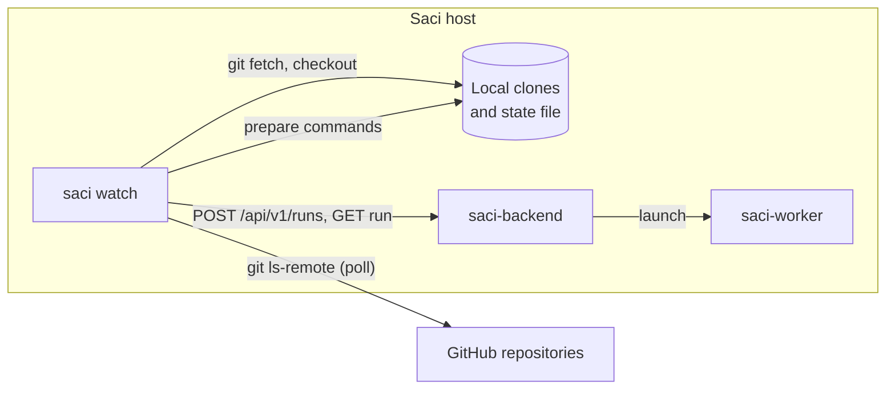

# Design: run test plans when code changes

Status: proposal ([#135](https://github.com/orpiske/midnight-saci/issues/135)). Nothing in this document is implemented.

## Goal

When code is merged into a watched branch on GitHub, Saci runs the
related test plans without a person. Two constraints apply:

- GitHub cannot reach the host where Saci runs. GitHub Actions and
  webhooks are not available. A process on that host must find the
  changes itself.
- The system under test can be split across several repositories. For
  example, Wanaku has a server, an operator and a test repository. A
  change in one repository, or related merges in several repositories,
  must give one test cycle against one consistent set of commits.

## Overview

A new command, `saci watch`, runs on the Saci host as a long-running
process. It does not change the backend's role: it is a client of the
REST API, like `saci run`.



One cycle:

1. **Poll.** At each interval, the watcher runs `git ls-remote` for the
   branch of each repository and compares the commit with the last
   commit that it saw.
2. **Wait for quiet.** When a repository changed, the watcher waits until
   no watched repository changed for `quiet_period_secs`. Related merges
   in several repositories thus give one cycle.
3. **Snapshot.** The watcher fetches every repository of the project and
   checks out the current commit of its branch. The set of commits is the
   snapshot. All plans of the cycle use the same snapshot.
4. **Prepare.** The watcher runs the `prepare` commands of the trigger on
   the host, for example to build and push images or to deploy the system
   under test.
5. **Run.** The watcher reads each plan from the clones, submits it to the
   backend, and waits until the run ends before it submits the next plan.

## Detecting changes

The watcher uses `git ls-remote <url> refs/heads/<branch>`, not the GitHub
REST API:

- It needs no API token and has no API rate limit. A private repository
  uses the credentials that `git` already uses on the host (SSH agent or
  credential helper).
- It works with every Git host, not only GitHub.
- A merge, a squash merge, a rebase merge and a direct push all change the
  head of the branch. The watcher does not need to know which one it was.

The cost is one small request for each repository at each interval. The
default interval is 60 seconds.

Rejected alternatives:

- **Webhooks through a relay** (for example smee.io). This adds an
  external service that receives the events, and events are lost while
  the host is down.
- **The GitHub REST API.** It gives the pull request number and author,
  but needs a token, has rate limits and works only with GitHub. A later
  version can add these details to the run without a change to the
  detection.

## The clones

The watcher owns its clones in `<workdir>/repos/<name>`. It creates a
clone when it is missing. To update a clone, it runs `git fetch` and
`git checkout --force --detach <commit>`, then `git clean -ffdx`. Local
changes in a clone are lost. Do not edit the clones by hand.

Clones that the watcher owns give a known state for each cycle. A
person's working copy can have local changes, another branch or build
output, and the watcher must not change it.

## Projects and triggers

The configuration has one list of repositories and one list of triggers.
A trigger names the repositories that start it and the plans that it
runs. Repositories that only supply code or plans, for example the test
repository, are in the snapshot but do not need to start a trigger.

```yaml
backend:
  url: http://127.0.0.1:18080       # default: --backend or SACI_BACKEND_URL
  token: { env: SACI_TOKEN }        # optional
workdir: ~/.local/state/saci-watch  # clones and the state file
poll_interval_secs: 60
quiet_period_secs: 180
repositories:
  - name: wanaku
    url: https://github.com/wanaku-ai/wanaku.git
    branch: main
  - name: wanaku-operator
    url: https://github.com/wanaku-ai/wanaku-operator.git
    branch: main
  - name: wanaku-tests
    url: git@github.com:wanaku-ai/wanaku-tests.git
    branch: main
triggers:
  - name: operator
    on: [wanaku, wanaku-operator, wanaku-tests]
    prepare:
      - name: build images
        dir: wanaku-operator            # a repository name; the command runs in its clone
        run: make image push
        timeout_secs: 1800
    plans:
      - plan: wanaku-tests/tests/plans/operator-basic-functionality.md
        environment: openshift
        policy: keep-going
      - plan: wanaku-tests/tests/plans/operator-upgrade.md
        environment: openshift
```

- `on` lists the repositories whose changes start the trigger. A change
  in a repository that no trigger names is ignored.
- `plan` is a path in the clones: the repository name, then the path in
  that repository.
- `prepare` commands run with `bash -c`, in order, on the host. They get
  the snapshot as environment variables (see below). A failed or timed
  out command ends the cycle: the watcher logs the reason and submits no
  plans. The next change starts a new cycle.
- When two triggers start from the same change, they run one after the
  other, in configuration order.

## The commits in the run

The plans and the report must show which commits were tested. The
watcher gives each repository of the snapshot to the run as a parameter:

| Parameter | Value |
| --- | --- |
| `SOURCE_<NAME>_COMMIT` | The commit SHA. |
| `SOURCE_<NAME>_URL` | The repository URL. |
| `SOURCE_<NAME>_BRANCH` | The branch. |

`<NAME>` is the repository name in upper case, with `-` changed to `_`,
for example `SOURCE_WANAKU_OPERATOR_COMMIT`. A plan can use the values,
for example to deploy the image tag of the commit or to clone the code in
the worker. The `prepare` commands get the same variables.

This needs one backend change: `SubmitRun` gets an optional `parameters`
field. The backend adds these values to the environment's `parameters`
for this run only. A key that the environment already defines, or that
breaks the rules of `parameters`, is rejected with 422. Secrets cannot be
given this way. The report and the run page Environment tab show the run
parameters. `saci run` gets `--param NAME=VALUE`, which is also useful
without the watcher.

The worker does not get the clones. Workers mount no host directories
([launchers](../launchers.md)), and a mount does not work with Kubernetes
Jobs. A plan that needs the code in the worker clones it at
`SOURCE_<NAME>_COMMIT`.

## One cycle at a time

Test plans of one project often use one shared system under test, for
example one OpenShift namespace. Two cycles at the same time can break
each other. Thus:

- The watcher runs one cycle at a time, and the plans of a cycle one
  after the other.
- When changes arrive during a cycle, the watcher does not stop the
  current run. After the cycle, it starts one new cycle with the newest
  snapshot. Intermediate snapshots are not tested.
- The watcher waits for a run with `GET /api/v1/runs/{id}` until the run
  ends. A failed plan does not stop the next plans of the cycle.

## Restarts and duplicates

The watcher keeps its state in `<workdir>/state.json`: the last snapshot
that it saw, the last snapshot that it tested for each trigger, and the
run that it waits for. It writes the file to a temporary file and renames
it, so a crash cannot leave a partial file.

- **First start.** Without a state file, the watcher records the current
  commits and starts no cycle. `--run-now` starts a cycle at once.
- **Restart during a cycle.** The watcher reads the state, waits for the
  recorded run, then continues with the next plans.
- **No duplicate runs.** The `Idempotency-Key` of each submission is
  `watch:<trigger>:<snapshot hash>:<plan index>`. When the watcher
  submits a run again after a lost reply or a crash, the backend returns
  the run that it already accepted.

## Command line

```sh
saci watch --config watch.yaml [--once] [--run-now]
saci watch status --config watch.yaml
```

- `saci watch` polls until it is stopped. On SIGINT or SIGTERM it stops
  after the current request. It does not cancel a running test run.
- `--once` polls one time, runs a cycle when a change is found, and exits.
  This is for tests and for hosts that use cron or a systemd timer.
- `saci watch status` shows the snapshot, the last cycle of each trigger
  with its runs and outcomes, and the run that the watcher waits for.
- Log lines go to standard error, one line for each event: change found,
  cycle started, prepare command result, run submitted, run ended.

The user guide gives a systemd user unit and a launchd agent to start the
watcher with the host.

## Where the code goes

`saci watch` is a module of `saci-cli`. The CLI already has the REST
client, the plan bundle loader and the backend settings. The watcher uses
the `git` program, as investigations do, and no Git library. The backend
does not change, except for run parameters.

## Notifications

The watcher does not send notifications. The backend's
[outcome actions](../actions.md) already report run results, for example
by email. A failed `prepare` command is only in the watcher log. If this
is not sufficient, a later version can run a configured command when a
cycle fails.

## Security

- The configuration file is trusted: it contains commands that run on the
  host with the rights of the watcher's user.
- Values from the repositories (branch heads, commit messages) never
  become part of a command. The watcher gives them to commands as
  environment variables only.
- The backend token comes from an environment variable, never from the
  file.
- `git clean -ffdx` removes files in the clones only. The watcher refuses
  a `workdir` that is a Git working tree or the home directory.

## Not in scope

- Pull requests that are not merged, tags and releases.
- Path filters (start a trigger only when some files change).
- More than one cycle at the same time.
- A console page for the watcher.
- Investigations that use the run's commits as the default refs. This is
  a small follow-up when both features exist.

## Tickets

1. **Run parameters**: `parameters` in `SubmitRun`, validation, the
   report and console, `saci run --param`, `docs/openapi.yaml` and the
   web API types.
2. **Watcher core**: configuration, `git ls-remote` polling, the quiet
   period, the clones and the snapshot, the state file, submission with
   idempotency keys, waiting for runs, `--once`, `--run-now` and
   `saci watch status`. Tests use local bare repositories (`file://`
   URLs) and the `saci-testkit` backend fixtures.
3. **Prepare commands**: the `prepare` list with directory, timeout and
   the snapshot variables.
4. **Docs and examples**: a user guide in `docs/watch.md`, an example
   configuration for a project in several repositories in `examples/`,
   and the systemd and launchd units.

Ticket 2 depends on 1. Tickets 3 and 4 depend on 2.
